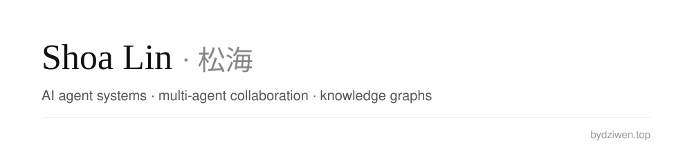

前知识图谱研究员，曾任企业架构师，长期从事企业数字化转型。现专注 AI Agent 系统，研究方向为多 Agent 的组织与协作。 
Former knowledge-graph researcher and enterprise architect with a background in enterprise digital transformation. Now building AI agent systems, with a focus on multi-agent organization and collaboration.

### What I work on · 关注方向

- **AI Agent 系统：多 Agent 的组织与协作** 
  AI agent systems — multi-agent organization and collaboration
- **知识图谱研究：知识表示、本体与 NLP** 
  Knowledge-graph research — knowledge representation, ontology and NLP
- **企业架构与数字化转型：曾任比亚迪数字化企业架构师（TOGAF / DAMA）** 
  Enterprise architecture and digital transformation — formerly digital enterprise architect at BYD (TOGAF / DAMA)

### Selected projects · 项目

| Project | About |
| --- | --- |
| [shoa-site](https://github.com/shoa-lin/shoa-site) | Source of my personal site · 个人主页 |
| [deepseek-harness-desktop](https://github.com/shoa-lin/deepseek-harness-desktop) | DeepSeek Harness with a Windows desktop build: an Electron shell over the dsh web profile |
| [realtime_dialog](https://github.com/shoa-lin/realtime_dialog) | Doubao S2S example · 豆包端到端实时语音示例 |
| [academic-talent-map](https://github.com/shoa-lin/academic-talent-map) | ATLAS academic talent map demo |

Also tracking / 在用的分支：[xLyra](https://github.com/shoa-lin/xLyra) (multi-site AI gateway), [html-report-style](https://github.com/shoa-lin/html-report-style), [uu-remote-linux](https://github.com/shoa-lin/uu-remote-linux).

### Recent writing · 近期文章

- [越改越会改：AI 自我改进卡在哪](https://www.bydziwen.top/blog/rsi-verification)
- [能碰什么，知道什么：agent 为什么一直换形态](https://www.bydziwen.top/blog/agent-permission-context)
- [Jev 与 System One：Agent 需要决策层，而不是更多聊天](https://www.bydziwen.top/blog/jev-system-one-decision-layer)
- [从 Fable 5 到 Fable 5.1：系统提示词正在长成 Agent OS](https://www.bydziwen.top/blog/fable-5-1-prompt-harness-evolution)

More → [bydziwen.top/blog](https://www.bydziwen.top/blog)

### Contact · 联系

[bydziwen.top](https://www.bydziwen.top) · [X @pand_lin](https://x.com/pand_lin) · Guangzhou 广州
